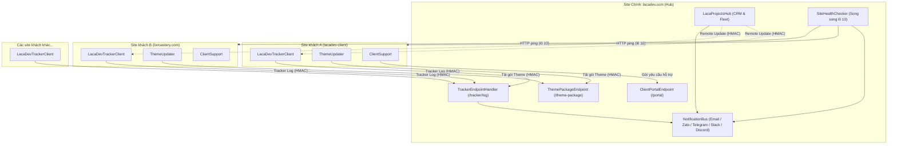
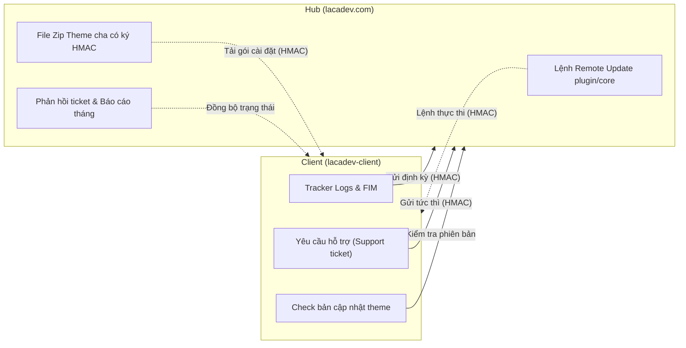
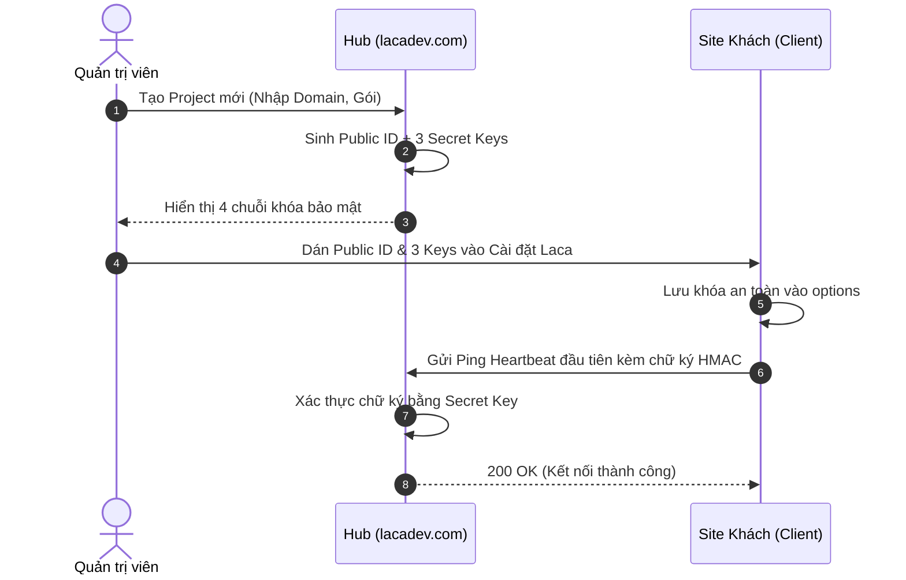
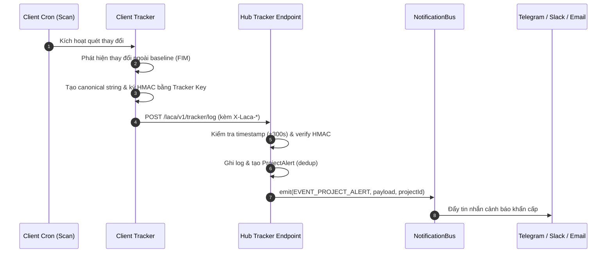
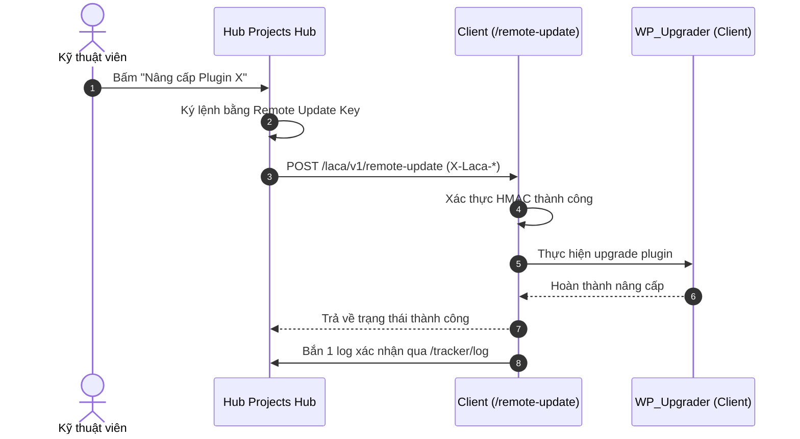
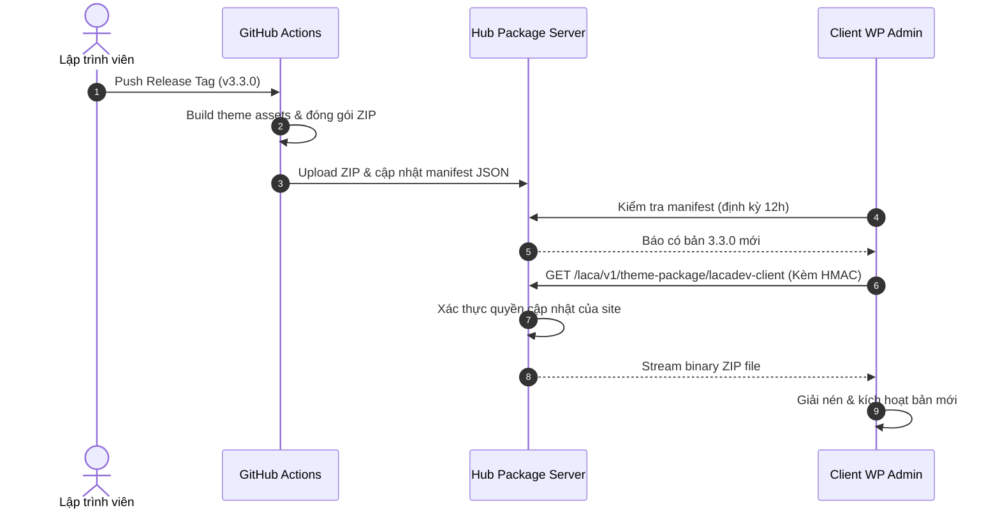
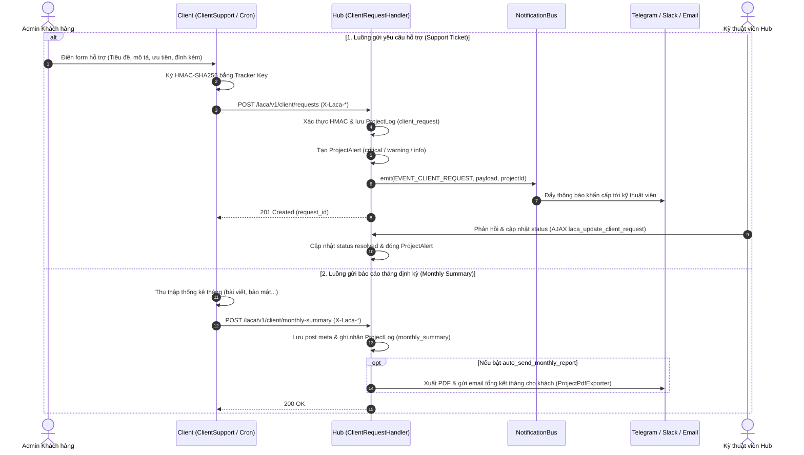
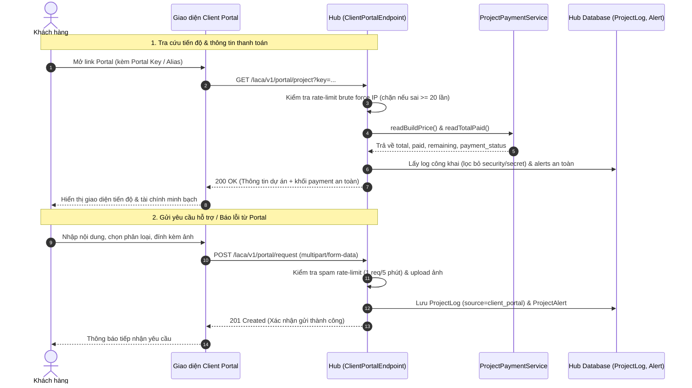

# TÀI LIỆU TỔNG HỢP HỆ THỐNG LACADEV (HUB & CLIENT)

Tài liệu kỹ thuật tổng hợp toàn bộ kiến trúc, chức năng, flow vận hành và quy chuẩn bảo mật của hệ thống **Lacadev Framework** (phiên bản cập nhật tháng 11/2026).

---

## 1. Tổng quan kiến trúc

### 1.1 Sơ đồ mô hình Hub ↔ Spoke
Hệ thống hoạt động theo mô hình tập trung **Hub và Spoke**:
- **Hub (`lacadev.com`)**: Quản lý tập trung toàn bộ danh sách dự án (CPT `project`), fleet monitoring (uptime, SSL, domain), nhận nhật ký tracker, phân phối bản cập nhật theme và quản lý hỗ trợ khách hàng (Client Portal).
- **Spokes (Site khách)**: Các website chạy theme cha `lacadev-client` độc lập (như `lacadev-client.local`, `lixroastery.com`, `nhakhoathienphuoc.vn`, `phucdainam.com`...), kèm theme con (child theme) tuỳ biến cho từng khách hàng.



### 1.2 Tech Stack & Cấu trúc thư mục
- **WordPress**: Core CMS (WordPress 6.7+).
- **WPEmerge Framework**: Cung cấp routing (`web.php`, `admin.php`, `ajax.php`), middleware, IoC Container và Service Providers.
- **Carbon Fields**: Cấu hình theme options, post meta, block attributes.
- **Composer PSR-4**: Không gian tên chuẩn `App\` ánh xạ vào `app/src/`.
- **Cấu trúc lồng cấp thư mục `theme/`**: Theme header `style.css` và template gốc nằm trong `theme/` (slug cài đặt: `lacadev/theme` hoặc `lacadev-client/theme`), trong khi code logic nằm ở cấp theme root (`app/`).

### 1.3 Bảng quản lý kho mã nguồn (Repositories) & Deploy

| Repo / Theme | Vai trò | Đường dẫn local | Domain local / prod | CI/CD Workflow |
| --- | --- | --- | --- | --- |
| `lacadev` (`M` / `MR`) | Site Hub quản lý | `/Users/lacadev/Documents/wordpress/lacadev` | `lacadev.local` / `lacadev.com` | GitHub Actions: Push `master` → FTP Sync → Smoke test |
| `lacadev-client` (`CP` / `CR`) | Theme cha site khách | `/Users/lacadev/Documents/wordpress/lacadev-client` | `lacadev-client.local` | GitHub Actions: Release tag → Build Zip & Manifest |
| `lacadev-client-child` (`CC`) | Theme con site khách | `.../themes/lacadev-client-child` | `lacadev-client.local` | Deploy theo repo client |

---

## 2. Site chính (Hub) — Danh mục chức năng

### 2.1 Quản lý dự án (CPT `project`, CRM Dashboard & Fleet)

| Chức năng | Mô tả chi tiết | Class / File chính | Màn hình Admin / Route |
| --- | --- | --- | --- |
| **CPT `project`** | Khai báo Custom Post Type `project` lưu trữ hồ sơ từng website khách hàng, các trường meta (URL, SSH/FTP, hạn hosting/domain, 4 khóa HMAC API, gói bảo trì). | `App\PostTypes\ProjectPostType`<br>`App\Features\ProjectManagement\ProjectFields` | `wp-admin/edit.php?post_type=project` |
| **Laca Projects Hub** | Bảng điều khiển CRM tập trung 16 trang quản lý: Dashboard, Action Center, Pipeline, Health Score, Khách hàng, Issues, Updates, Renewals, Vận hành, Finance, Reports, Portal preview, Notifications Center, PDF Export, Tracker Export, Block Catalog. | `App\Features\ProjectManagement\LacaProjectsHub` | `wp-admin/admin.php?page=laca-projects` |
| **Fleet Monitoring** | Tổng hợp nhanh trạng thái toàn bộ website khách (Uptime, Core/Plugin Outdated, SSL/Domain Expiration, FIM alert). | `App\Features\ProjectManagement\LacaProjectsHub` | Trang `pipeline` & `dashboard` |
| **Project PDF Exporter** | Xuất báo cáo dự án định dạng PDF/HTML, gửi email tổng kết tiến độ và tài chính cho chủ dự án. | `App\Features\ProjectManagement\ProjectPdfExporter` | Meta box trong trang chỉnh sửa `project` |

### 2.2 Theo dõi và cảnh báo (Monitoring & Health-check)

| Chức năng | Mô tả chi tiết | Class / File chính | Màn hình Admin / Route |
| --- | --- | --- | --- |
| **Tracker Log Receiver** | Điểm tiếp nhận nhật ký biến động từ client (thay đổi file, đổi plugin/theme, cập nhật core). | `App\Settings\LacaTools\TrackerEndpointHandler` | `POST /wp-json/laca/v1/tracker/log` |
| **Uptime Monitor Song Song** | Kiểm tra uptime toàn bộ site khách theo lô 10 site song song qua `Requests::request_multiple`, timeout 10s. Ghi log phản hồi (`response_ms`, mã HTTP) vào bảng `wp_laca_uptime_log`. | `App\Settings\LacaTools\SiteHealthChecker`<br>`App\Databases\UptimeLogTable` | Cron `laca_health_check_event` (hàng giờ) |
| **Cảnh báo hết hạn SSL & Domain** | Tự động quét và cảnh báo trước 14 ngày khi SSL hoặc Domain/Hosting của site khách sắp hết hạn. | `App\Settings\LacaTools\ProjectNotificationHandler` | Cron `laca_project_check_expirations` (hàng ngày) |
| **Cron Health Monitor** | Giám sát trạng thái hoạt động của cron hệ thống, cảnh báo nếu cron bị trễ quá 30 phút. | `App\Features\DiscordHub\Monitors\CronHealthMonitor` | Cron `lacadev_cron_health_check` |

### 2.3 Hệ thống thông báo hợp nhất (`NotificationBus`)

| Chức năng | Mô tả chi tiết | Class / File chính | Kênh tích hợp |
| --- | --- | --- | --- |
| **Event Bus Hợp nhất** | Điểm trung chuyển `NotificationBus::emit()` định tuyến sự kiện tới các kênh thông báo với cơ chế chống trùng (dedup) theo cooldown. | `App\Notifications\NotificationBus` | Tất cả kênh |
| **Email Thông báo** | Gửi email thông báo HTML chuẩn hóa về sự cố hoặc báo cáo định kỳ. | `App\Settings\LacaTools\ProjectNotificationHandler` | SMTP / `wp_mail` |
| **Zalo OA Notification** | Gửi thông báo ZNS / Zalo OA với cơ chế tự động làm mới access token qua refresh token khi hết hạn. | `App\Settings\LacaTools\ProjectNotificationHandler` | Zalo OpenAPI |
| **Telegram Bot** | Bắn tin nhắn Markdown báo động khẩn cấp tới nhóm Telegram quản trị. | `App\Settings\LacaTools\ProjectNotificationHandler` | Telegram Bot API |
| **Slack / Discord** | Gửi Webhook Rich Embed tới kênh giám sát Slack / Discord của kỹ thuật viên. | `App\Settings\LacaTools\ProjectNotificationHandler`<br>`App\Features\DiscordHub\DiscordWebhookSender` | Incoming Webhooks |

### 2.4 Client Portal & Thanh toán

| Chức năng | Mô tả chi tiết | Class / File chính | Màn hình Admin / Route |
| --- | --- | --- | --- |
| **Portal Endpoint** | Cung cấp thông tin dự án, danh sách yêu cầu và tiến độ cho khách hàng tra cứu qua token hoặc cookie đăng nhập. | `App\Settings\LacaTools\ClientPortalEndpoint` | `GET /wp-json/laca/v1/portal/project`<br>`POST /wp-json/laca/v1/portal/request` |
| **Theo dõi thanh toán** | Hiển thị tình trạng hợp đồng, các đợt thanh toán, trạng thái quá hạn hoặc gia hạn bảo trì hàng năm. | `App\Settings\LacaTools\ClientPortalEndpoint` | Tab "Portal" trong Laca Projects |

### 2.5 Yêu cầu hỗ trợ & Báo cáo tháng

| Chức năng | Mô tả chi tiết | Class / File chính | Màn hình Admin / Route |
| --- | --- | --- | --- |
| **Client Request Hub** | Tiếp nhận, xử lý yêu cầu chỉnh sửa/hỗ trợ từ khách hàng, phân loại mức độ ưu tiên (Low, Normal, High, Urgent/Bug). | `App\Settings\LacaTools\ClientRequestHandler` | `GET / POST /wp-json/laca/v1/client/requests`<br>`wp-admin/admin.php?page=laca-projects&tab=issues` |
| **Monthly Summary Report** | Tạo báo cáo tổng kết hàng tháng cho từng site: số lượt cập nhật plugin/core, số sự cố uptime, số ticket đã giải quyết. | `App\Settings\LacaTools\ClientRequestHandler` | `GET /wp-json/laca/v1/client/monthly-summary` |

### 2.6 Phân phối cập nhật Theme & Block Catalog

| Chức năng | Mô tả chi tiết | Class / File chính | Màn hình Admin / Route |
| --- | --- | --- | --- |
| **Theme Package Distribution** | Cấp phát file zip cập nhật theme cha `lacadev-client` cho các site khách được cấp phép, xác thực HMAC. | `App\Settings\LacaTools\ThemePackageEndpoint` | `GET /wp-json/laca/v1/theme-package/(?P<slug>[a-zA-Z0-9_\-]+)` |
| **Block Catalog Hub** | Danh mục block Gutenberg của toàn hệ thống, cung cấp metadata để site khách tra cứu và đồng bộ block mới. | `App\Settings\LacaTools\BlockCatalogHub` | `GET /wp-json/laca/v1/blocks-catalog` |

### 2.7 SEO, Bảo mật & Công cụ quản trị khác

| Chức năng | Mô tả chi tiết | Class / File chính | Màn hình Admin / Route |
| --- | --- | --- | --- |
| **Laca SEO Engine** | Module SEO tích hợp: Quản lý Redirects (301/302), Giám sát lỗi 404 (404 Monitor), OpenGraph, Schema JSON-LD. | `App\Features\LacaSeo\LacaSeo`<br>`App\Features\LacaSeo\Modules\Redirections\Redirections`<br>`App\Features\LacaSeo\Modules\NotFoundMonitor\NotFoundMonitor` | `wp-admin/admin.php?page=laca-seo` |
| **Bảo mật Laca** | Chống Brute Force đăng nhập, Two-Factor Authentication (2FA TOTP), Quét Hidden Super-User, File Integrity Monitor. | `App\Settings\LacaTools\Security`<br>`App\Settings\Security\SecurityManager` | `wp-admin/admin.php?page=laca-security` |
| **Tối ưu hóa hệ thống** | Tối ưu DB, dọn dẹp revisions, tắt XML-RPC, tối ưu hóa CSS/JS và hình ảnh WebP. | `App\Settings\LacaTools\Optimize`<br>`App\Settings\ThemeSettings` | `wp-admin/admin.php?page=laca-optimize` |

### 2.8 Giao diện quản trị (UI Component Kit)
- **Hệ thống Token**: Sử dụng bộ token Chakra v3 `--laca-*` (`--laca-primary`, `--laca-bg-surface`, `--laca-border-subtle`, `--laca-radius-md`...).
- **Component tiêu chuẩn**: `.laca-card`, `.laca-btn`, `.laca-badge`, `.laca-alert`, `.laca-table-wrap`, `.laca-progress`.
- **Trang mẫu tham chiếu**: `wp-admin/admin.php?page=laca-ui-kit`.

---

## 3. Site khách (Client) — Danh mục chức năng

### 3.1 Theme cha (`lacadev-client`)

| Chức năng | Mô tả chi tiết | Class / File chính | Ghi chú |
| --- | --- | --- | --- |
| **Tracker Client** | Theo dõi thay đổi FIM (File Integrity), biến động plugins/theme, gửi heartbeat định kỳ về Hub. Hứng lệnh Remote Update từ Hub. | `App\Settings\LacaDevTrackerClient` | Cron `laca_tracker_hourly_scan`, `laca_tracker_daily_digest`, `laca_tracker_heartbeat` |
| **Remote Update Receiver** | Tiếp nhận lệnh từ Hub để thực thi cập nhật plugin/core/theme từ xa một cách an toàn. | `App\Settings\LacaDevTrackerClient` | `POST /wp-json/laca/v1/remote-update` |
| **Theme Updater** | Kiểm tra phiên bản mới từ Hub (qua endpoint `/theme-package`), tải gói zip đã ký HMAC và tự động cài đặt qua WordPress Upgrader. | `App\Settings\ThemeUpdater` | Hook vào filter `site_transient_update_themes` |
| **Client Support Widget** | Widget gửi yêu cầu hỗ trợ và báo lỗi trực tiếp từ wp-admin của site khách về Hub. | `App\Settings\ClientSupport` | Đặt tại Dashboard wp-admin |
| **Bảo mật Client** | Chặn dò tìm user (`author=?`), bảo vệ trang đăng nhập, ghi log đăng nhập thất bại. | `App\Settings\Security\SecurityManager`<br>`App\Settings\Security\UserEnumerationGuard` | |
| **Email Log** | Ghi nhận toàn bộ email được gửi từ site khách vào custom DB table để tra cứu khi khách không nhận được mail. | `App\Settings\EmailLog\EmailLogManager`<br>`App\Settings\EmailLog\EmailLogTable` | Bảng `wp_laca_email_log` |
| **Dynamic CPT & Meta Editor** | Cho phép khai báo nhanh CPT và Taxonomy mới trực tiếp trong wp-admin mà không cần đụng code. | `App\Settings\DynamicCPT\DynamicCptManager` | |
| **Block Marketplace Receiver** | Nhận và cài đặt các block Gutenberg được push từ Hub. | `App\Settings\BlockSyncReceiver` | `POST /wp-json/laca-sync/v1/blocks` |

### 3.2 Theme con (`lacadev-client-child`)
- **Custom Blocks Gutenberg**: Thư mục `block-gutenberg/` chứa các block đặc thù của giao diện (Hero, Testimonials, Product Showcase...).
- **Newsletter Module**: Xử lý đăng ký nhận tin của khách truy cập, lưu trữ danh sách hoặc gửi về CRM bên ngoài.
- **Custom Templates**: Ghi đè giao diện bài viết, chuyên mục, layout phù hợp với nhận diện thương hiệu khách hàng.

### 3.3 Trao đổi 2 chiều giữa Hub và Client



---

## 4. Các luồng hoạt động chính (Workflows & Diagrams)

### 4.1 Đăng ký website khách vào Hub
1. Quản trị viên tạo mới một bài viết trong CPT `project` trên Hub.
2. Hệ thống tự động sinh bộ 4 thông tin xác thực duy nhất:
   - `_laca_public_id`: Mã định danh công khai (`prj_xxxxxxx`).
   - `_laca_key_tracker`: Khóa bí mật dùng cho Tracker (`trk_...`).
   - `_laca_key_catalog`: Khóa bí mật dùng cho Block Catalog (`cat_...`).
   - `_laca_key_remote`: Khóa bí mật dùng cho Remote Update (`rmt_...`).
3. Quản trị viên copy 4 giá trị này dán vào màn hình **Cài đặt Laca → Kết nối Hub** trên site khách.
4. Site khách thực hiện test kết nối bằng cách gửi heartbeat đầu tiên về Hub.



### 4.2 Luồng gửi Tracker Log & Phát cảnh báo
1. Cron trên client (`laca_tracker_hourly_scan`) phát hiện file core/plugin bị sửa đổi hoặc plugin bị vô hiệu hóa.
2. Client đóng gói payload JSON, tạo chữ ký HMAC-SHA256 với Tracker Key.
3. Client gửi `POST /wp-json/laca/v1/tracker/log` với 3 headers: `X-Laca-Project`, `X-Laca-Timestamp`, `X-Laca-Signature`.
4. Hub nhận request, kiểm tra cửa sổ thời gian (300 giây) và tính lại HMAC.
5. Nếu khớp, Hub lưu log vào CPT `project` và tạo `ProjectAlert`.
6. `NotificationBus::emit()` được kích hoạt, bắn cảnh báo tức thì tới Telegram/Slack/Email cho kỹ thuật viên.



### 4.3 Chuẩn xác thực chữ ký HMAC Request
Mọi giao tiếp nhạy cảm giữa Hub và Client đều bắt buộc xác thực chữ ký điện tử HMAC-SHA256:
- **Headers bắt buộc**:
  - `X-Laca-Project`: Public ID của dự án (`prj_...`).
  - `X-Laca-Timestamp`: Unix timestamp (UTC) tại thời điểm gửi.
  - `X-Laca-Signature`: Chuỗi hex của chữ ký HMAC-SHA256.
- **Chuỗi chuẩn hoá (Canonical String)**:
  ```text
  METHOD . "\n" . PATH . "\n" . TIMESTAMP . "\n" . sha256(RAW_BODY)
  ```
- **Chống Replay Attack**:
  - Timestamp không được chênh lệch quá 300 giây so với đồng hồ máy chủ nhận.
  - Nonce/Chữ ký được lưu tạm vào Transient Cache trong 10 phút để từ chối các request gửi lại y hệt.
- **Chế độ Legacy (`laca_allow_legacy_auth`)**:
  - Tùy chọn hệ thống cho phép fallback tạm thời cho các client cũ (bản < 3.2). Mặc định tắt trên môi trường sản xuất.

### 4.4 Lệnh Remote Update (Hub ra lệnh cho Client)
1. Kỹ thuật viên click nút "Cập nhật WordPress Core" hoặc "Cập nhật Plugin" trên Hub CRM.
2. Hub tạo request POST tới endpoint `POST /wp-json/laca/v1/remote-update` trên client, ký bằng `_laca_key_remote`.
3. Client xác thực HMAC, chuyển giao tác vụ cho `WP_Upgrader`.
4. Client hoàn tất nâng cấp, phản hồi JSON kết quả và tự động gửi 1 tracker log xác nhận về Hub.



### 4.5 Phân phối cập nhật Theme qua CI/CD
1. Developer hoàn thành phiên bản theme mới, tạo git tag (vd `v3.3.0`) trên repo `lacadev-client`.
2. GitHub Actions tự động đóng gói file zip theme và sinh file manifest `lacadev-client.json`.
3. Site khách định kỳ kiểm tra `site_transient_update_themes`, đọc manifest từ Hub.
4. Khi admin bấm cập nhật, WordPress gửi request tới Hub endpoint `/laca/v1/theme-package/lacadev-client` với chữ ký HMAC.
5. Hub kiểm tra quyền tải gói, sau đó stream trực tiếp nội dung file zip về client.



### 4.6 Uptime Monitor & Xử lý sự cố
1. Cron hàng giờ của Hub (`laca_health_check_event`) kích hoạt `SiteHealthChecker`.
2. Kiểm tra danh sách URL của các dự án đang hoạt động theo từng lô 10 site song song.
3. Nếu 1 site phản hồi lỗi HTTP 5xx hoặc timeout:
   - Hub tăng bộ đếm số lần lỗi liên tiếp (`_uptime_fail_count`).
   - Nếu lỗi 2 lần liên tiếp: Bắn sự kiện `EVENT_UPTIME_DOWN` qua `NotificationBus` báo động khẩn cấp.
4. Khi site hồi phục (HTTP 200), bắn sự kiện `EVENT_UPTIME_UP` thông báo đã hoạt động trở lại.

### 4.7 Yêu cầu hỗ trợ từ khách & Báo cáo tháng định kỳ (Support Request & Monthly Summary)
1. **Gửi yêu cầu hỗ trợ (Support Ticket)**:
   - Khách hàng điền form hỗ trợ tại widget `ClientSupport` trong wp-admin site khách.
   - Client tạo chữ ký HMAC-SHA256 bằng Tracker Key và gửi `POST /wp-json/laca/v1/client/requests` (kèm headers `X-Laca-*`).
   - Hub tiếp nhận tại `ClientRequestHandler::handleCreateRequest()`:
     - Xác thực chữ ký HMAC qua `RequestSigner::verify()`.
     - Lưu yêu cầu vào `ProjectLog` (loại `client_request`, trạng thái ban đầu `pending`).
     - Tạo cảnh báo trong `ProjectAlert` với mức độ ưu tiên tương ứng (`critical` cho khẩn cấp, `warning` cho mức cao, `info` cho bình thường).
     - Phát sự kiện qua `NotificationBus::emit(NotificationBus::EVENT_CLIENT_REQUEST)` để gửi cảnh báo khẩn cấp tức thì tới Telegram/Slack/Email đội ngũ kỹ thuật.
   - Kỹ thuật viên xem danh sách và xử lý ticket tại Hub (`wp-admin/admin.php?page=laca-projects&tab=issues`). Khi cập nhật trạng thái (`processing`, `resolved`) và câu trả lời qua AJAX `laca_update_client_request`, `ProjectAlert` tương ứng tự động được giải quyết (`resolved`).
   - Site khách có thể tra cứu lịch sử xử lý qua `GET /wp-json/laca/v1/client/requests`.
2. **Gửi báo cáo tháng tự động (Monthly Summary)**:
   - Cron định kỳ trên site khách tổng hợp số liệu hoạt động trong tháng: số bài viết/trang mới, số sự cố bảo mật, dữ liệu GA4/GSC.
   - Client gửi `POST /wp-json/laca/v1/client/monthly-summary` với chữ ký HMAC-SHA256 về Hub.
   - Hub tiếp nhận tại `ClientRequestHandler::handleMonthlySummary()`, lưu vào post meta (`_laca_monthly_summary_{YYYY-MM}` và `_laca_last_monthly_summary`) và ghi nhật ký tự động vào `ProjectLog`.
   - Nếu dự án bật tùy chọn `auto_send_monthly_report`, Hub tự động kích hoạt `ProjectPdfExporter::sendMonthlyReportEmail()` để xuất báo cáo PDF và gửi email tổng kết cho khách hàng.



### 4.8 Client Portal & Hiển thị thông tin thanh toán (Client Portal & Payment Tracking)
1. **Truy cập Portal an toàn không cần đăng nhập**:
   - Khách hàng truy cập trang Portal riêng của dự án bằng Portal Key bí mật hoặc Portal Alias tùy biến (`?key={portal_key}`). Không yêu cầu tạo tài khoản người dùng WordPress trên Hub.
   - Hub tiếp nhận tại `ClientPortalEndpoint::getProjectData()`:
     - Cơ chế chống Brute-Force: Đếm số lần tra cứu sai key (`laca_portal_fail_{ip}`). Nếu sai quá 20 lần trong 15 phút, khóa IP tạm thời (khách hàng hợp lệ tải lại trang không bao giờ bị chặn).
     - Trả về thông tin tiến độ tổng quan: Timeline triển khai, ngày bàn giao, domain, gói bảo trì và thời hạn.
     - Lọc dữ liệu nhật ký công khai: Ẩn tuyệt đối các log nhạy cảm (`security`, `file_changed`), tự động che mã hash/secret bằng chuỗi `[ẩn mã bảo mật]`.
     - Chỉ hiển thị cảnh báo mức `info` và `warning`, ẩn các cảnh báo lỗi bảo mật nghiêm trọng.
2. **Hiển thị thông tin tài chính & thanh toán (`ProjectPaymentService`)**:
   - `ClientPortalEndpoint::buildPaymentInfo()` sử dụng `ProjectPaymentService` để tính toán:
     - `total`: Tổng giá trị hợp đồng (`readBuildPrice`).
     - `paid`: Tổng số tiền đã thanh toán (`readTotalPaid`).
     - `remaining`: Số tiền còn lại phải thanh toán (`total - paid`).
     - `status` & `status_label`: Trạng thái thanh toán (`pending`: Chưa thanh toán, `partial`: Đã thanh toán một phần, `paid`: Đã thanh toán đủ, `overdue`: Quá hạn).
   - **Bảo mật thông tin tài chính**: Chỉ công khai 4 thông số tổng hợp trên; tuyệt đối **không** để lộ ghi chú nội bộ (`finance_note`), file hoá đơn nhạy cảm (`invoice_file`), hay chi tiết từng đợt giải ngân (`pay_note`).
3. **Khách hàng gửi yêu cầu / Báo lỗi từ Portal**:
   - Khách gửi form từ Portal qua `POST /wp-json/laca/v1/portal/request` kèm key, loại yêu cầu (`request`, `bug`, `content`, `maintenance`, `billing`), người liên hệ, email, nội dung và tối đa 4 hình ảnh đính kèm.
   - Hub kiểm tra rate-limit chống spam (tối đa 1 request / 5 phút trên mỗi portal key + IP).
   - Lưu vào `ProjectLog` (loại `client_request`, nguồn `client_portal`), tạo `ProjectAlert` và kích hoạt chu trình xử lý của kỹ thuật viên.



### 4.9 Deploy Hub: GitHub Actions, FTP & Cơ chế Concurrency
1. Lập trình viên push commit lên nhánh `master` của repo `lacadev`.
2. Workflow `.github/workflows/deploy.yml` được kích hoạt.
3. Cấu hình quan trọng:
   ```yaml
   concurrency:
     group: deploy-production
     cancel-in-progress: false
   ```
   *Ý nghĩa*: Đảm bảo không có 2 tiến trình deploy FTP chạy đè lên nhau, ngăn chặn hoàn toàn hiện tượng lệch file `autoload_static.php` trên production (bài học sự cố ngày 03/11).
4. Trước khi upload, CI kiểm tra cú pháp PHP 8.3 (lỗi là dừng deploy). Sau khi FTP xong, bước health check gọi `/` và `/wp-login.php`; nếu có cấu hình secret thì gửi manifest cho giám sát file của site và tóm tắt lên Discord.

---

## 5. Bảng danh mục REST Endpoints

| Route | Method | Nơi đặt | Cơ chế xác thực | Class / Handler xử lý | Bên gọi |
| --- | --- | --- | --- | --- | --- |
| `/laca/v1/tracker/log` | `POST` | **Hub** | HMAC-SHA256 (`X-Laca-*`) | `App\Settings\LacaTools\TrackerEndpointHandler` | Client Tracker |
| `/laca/v1/theme-package/(?P<slug>[a-zA-Z0-9_\-]+)` | `GET` | **Hub** | HMAC-SHA256 (`X-Laca-*`) | `App\Settings\LacaTools\ThemePackageEndpoint` | Client ThemeUpdater |
| `/laca/v1/blocks-catalog` | `GET` | **Hub** | HMAC-SHA256 (`X-Laca-*`) | `App\Settings\LacaTools\BlockCatalogHub` | Client Admin |
| `/laca/v1/portal/project` | `GET` | **Hub** | Portal Key / Alias (`?key=...`) | `App\Settings\LacaTools\ClientPortalEndpoint` | Client Portal User |
| `/laca/v1/portal/request` | `POST` | **Hub** | Portal Key / Alias (`key=...`) | `App\Settings\LacaTools\ClientPortalEndpoint` | Client Portal User |
| `/laca/v1/client/requests` | `GET / POST` | **Hub** | HMAC-SHA256 (`X-Laca-*`) / Legacy Key | `App\Settings\LacaTools\ClientRequestHandler` | Client Support Widget |
| `/laca/v1/client/monthly-summary` | `POST` | **Hub** | HMAC-SHA256 (`X-Laca-*`) / Legacy Key | `App\Settings\LacaTools\ClientRequestHandler` | Client Monthly Cron |
| `/laca/v1/ai/chat` | `POST` | **Hub / Client** | Nonce / Cookie wp-admin | `App\Settings\LacaTools\AIChatHandler` | Admin Chat Panel |
| `/laca/v1/chatbot` | `POST` | **Hub / Client** | Public / Rate-limit | `App\Features\FrontendChatbot\FrontendChatbotHandler` | Khách truy cập web |
| `/laca/v1/remote-update` | `POST` | **Client** | HMAC-SHA256 (`X-Laca-*`) | `App\Settings\LacaDevTrackerClient` | Hub CRM Hub |
| `/laca-sync/v1/blocks` | `POST` | **Client** | Secret Key / HMAC | `App\Settings\BlockSyncReceiver` | Hub Push Sync |
| `/laca-sync/v1/catalog` | `GET / POST` | **Client** | Secret Key / HMAC | `App\Settings\BlockCatalogProvider` | Hub Catalog Pull |

---

## 6. Bảng danh mục Cron & Scheduled Events

| Tên Hook Cron | Chu kỳ | Nơi chạy | Trách nhiệm thực thi |
| --- | --- | --- | --- |
| `laca_health_check_event` | Hàng giờ (`hourly`) | **Hub** | Quét uptime song song toàn bộ site khách, lưu vào `wp_laca_uptime_log`. |
| `laca_project_check_expirations` | Hàng ngày (`daily`) | **Hub** | Quét hạn SSL, tên miền, hosting, gửi thông báo nhắc nhở trước 14 ngày. |
| `lacadev_cron_health_check` | 15 phút (`fifteen_minutes`) | **Hub / Client** | Kiểm tra cron hệ thống có chạy đúng giờ không, phát hiện trễ quá 30p. |
| `laca_tracker_hourly_scan` | Hàng giờ (`hourly`) | **Client** | Quét thay đổi file (FIM), phát hiện plugin bật/tắt hoặc có update mới. |
| `laca_tracker_daily_digest` | Hàng ngày (`daily`) | **Client** | Gửi báo cáo tổng kết tình trạng website trong 24h về Hub. |
| `laca_tracker_heartbeat` | 12 tiếng (`twicedaily`) | **Client** | Ping định kỳ xác nhận website vẫn đang kết nối thông suốt với Hub. |
| `lacadev_weekly_deep_audit` | Chủ nhật hàng tuần | **Hub / Client** | Quét sâu kiểm toán nội dung và dọn dẹp các bản ghi rác database. |

---

## 7. Các Options & Post Meta quan trọng

### 7.1 Meta của CPT `project` (trên Hub)
- `_live_url`: URL chính thức của website khách.
- `_laca_public_id`: Public ID định danh dự án (`prj_...`).
- `_laca_key_tracker`: Khóa HMAC nhận log tracker.
- `_laca_key_catalog`: Khóa HMAC cấp phát cập nhật theme / block catalog.
- `_laca_key_remote`: Khóa HMAC ra lệnh cập nhật từ xa.
- `_ssl_expiry`: Ngày hết hạn SSL (định dạng `YYYY-MM-DD`).
- `_ssl_notify_days`: Số ngày nhắc trước khi hết hạn SSL (mặc định `14`).
- `_uptime_last_status`: Trạng thái uptime gần nhất (`up` / `down`).
- `_uptime_fail_count`: Số lần lỗi liên tiếp được ghi nhận.

### 7.2 Options hệ thống (trên Hub & Client)
- `laca_allow_legacy_auth`: Cờ bật/tắt chế độ cho phép client cũ xác thực bằng query/header thường thay vì chữ ký HMAC.
- `laca_uptime_log_table_version`: Phiên bản migration của bảng `wp_laca_uptime_log`.
- `lacadev_hub_connection`: Cấu hình kết nối Hub trên site client (lưu Public ID, Keys, Hub URL).
- `lacadev_security_options`: Thiết lập module bảo mật (chặn user enumeration, whitelist IP, 2FA).

---

## 8. Hướng dẫn vận hành & Xử lý sự cố

### 8.1 Quy trình phát hành bản cập nhật Theme Client
1. Kiểm tra syntax và build assets trong `lacadev-client`:
   ```bash
   yarn build
   ```
2. Tạo git commit theo chuẩn Conventional Commits:
   ```bash
   git commit -m "feat(core): update tracker client protocol v3.3.0"
   ```
3. Tạo git tag phát hành:
   ```bash
   git tag v3.3.0
   git push origin master --tags
   ```
4. GitHub Actions sẽ tự động biên dịch và tạo gói `lacadev-client.zip` phân phối qua Hub.

### 8.2 Kiểm tra sau deploy
Bước **Kiểm tra site sau deploy** trong workflow tự gọi `/` và `/wp-login.php`; HTTP ≥ 500 hoặc trang có chuỗi `critical error`/`Fatal error` thì job báo lỗi (và báo Discord nếu có `DISCORD_DEPLOY_WEBHOOK`).

### 8.3 Bài học sự cố ngày 03/11/2026 (Lỗi 500 sau deploy Phase 9–12)
- **Hiện tượng**: Site `lacadev.com` gặp lỗi HTTP 500 do ClassNotFound hoặc gọi class cũ sau một chuỗi deploy liên tiếp.
- **Nguyên nhân cốt lõi**:
  1. Hai tiến trình GitHub Actions FTP Deploy chạy đồng thời (chồng chéo), ghi đè file `vendor/composer/autoload_static.php` không đồng bộ giữa các commit.
  2. File trạng thái FTP sync (`.ftp-deploy-sync-state.json`) bị lệch dẫn đến một số file PHP mới không được tải lên hosting.
- **Giải pháp triệt để đã áp dụng**:
  1. Bổ sung `concurrency` vào `.github/workflows/deploy.yml` với `cancel-in-progress: false` để các lượt deploy xếp hàng tuần tự.
  2. Đổi tên file trạng thái FTP sang `.ftp-deploy-sync-state-v2.json` để kích hoạt đồng bộ toàn bộ file sạch sẽ.

---

## 9. Việc còn tồn đọng & Định hướng (TODO / Backlog)

1. **Gỡ bỏ bước "Bait JSON"**: Khi toàn bộ site khách hàng trong mạng lưới nâng cấp lên phiên bản `lacadev-client` ≥ 3.2, sẽ gỡ bỏ hoàn toàn file JSON cập nhật tĩnh để chuyển 100% sang dynamic signed package endpoint.
2. **Đề xuất 11 `laca-core`**: Xem xét tách phần dùng chung giữa Hub và Client thành 1 thư viện Composer private hoặc WP MU-Plugin riêng (hiện đang tạm hoãn để tối ưu hoá code tại chỗ).
3. **Mở rộng Phase 8.5**: Triển khai kiểm thử cơ chế cập nhật tự động trên các website khách hàng thực tế tiếp theo (`nhakhoathienphuoc.vn`, `phucdainam.com`).

